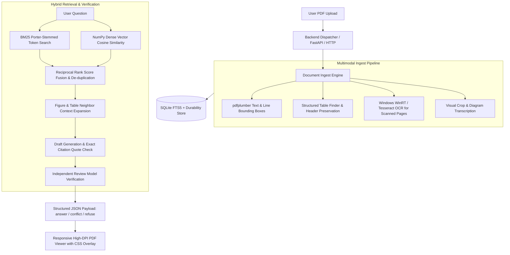

# PRISM AI — Technical Architecture Specification

**Project:** PRISM AI — Multimodal RAG with Explainability  
**Hackathon Problem Statement:** PS-03  
**Design Philosophy:** Evidence-First, Zero-Hallucination, Zero-Dependency Distribution  

---

## 1. System Architecture Overview

---

## 2. Core Architectural Pillars

### A. Document Intelligence & Multimodal Ingestion (`ingest.py`)
- **Text & Envelopes:** Lines are parsed with `pdfplumber.extract_text_lines()`. Consecutive lines within paragraph distance are merged into bounding box envelopes `[x0, top, x1, bottom]`.
- **Table Extraction:** `find_tables()` preserves table structure, isolating the header row (`Table first row`) and each subsequent data row (`Table row`) with exact row-level coordinates.
- **Native Windows OCR (`windows_ocr.ps1`):** Uses Windows 10/11 WinRT `Windows.Media.Ocr.OcrEngine` directly via PowerShell, eliminating heavy binary installation requirements on Windows and extracting character-level bounding rects.
- **Visual Transcription:** Vector plots and raster figures are isolated and cropped at high resolution for multimodal model transcription.

### B. High-Performance Hybrid Storage & Retrieval (`store.py`, `research.py`)
- **FTS5 BM25 Virtual Table:** Full-text Porter tokenized index (`fts5(body, tokenize='porter unicode61')`) with automated SQLite insert/delete triggers.
- **Dense Vector Search:** Embeddings stored as binary BLOBs and compared using NumPy in-memory dot products.
- **Reciprocal Rank Fusion (RRF):** Fuses lexical and semantic scores (`1 / (40 + rank)`).
- **Source Concentration Cap:** Caps chunks per document to prevent any single large report from dominating candidate evidence.
- **Neighbor Expansion:** When named figures (e.g., *"Chart IV.13"*) or table rows are retrieved, adjacent page records are automatically pulled into context.

### C. Zero-Hallucination & Independent Verification (`research.py`)
1. **Passage Citation Validation:** The model must return an exact verbatim quote copied from the retrieved evidence. If the quote is missing or modified, the answer is rejected.
2. **Two-Document Conflict Enforcement:** A `conflict` status is strictly forbidden unless supported by citations from at least two different documents.
3. **Independent Sufficiency Verification:** A secondary model evaluation reviews the draft answer against the citations for units, arithmetic, and period alignment. If any claim is unverified, it issues an immediate `refuse`.

### D. Explainable Evidence Viewer (`viewer.js`, `style.css`)
- Zero-build native ES Modules UI.
- Displays high-DPI rasterized pages generated on-the-fly by `pypdfium2`.
- Highlights are projected using relative percentage coordinates:
  $$\text{left} = \frac{x_0}{W} \times 100\%, \quad \text{top} = \frac{y_0}{H} \times 100\%, \quad \text{width} = \frac{x_1 - x_0}{W} \times 100\%, \quad \text{height} = \frac{y_1 - y_0}{H} \times 100\%$$
- Immune to client-side font rendering differences.
